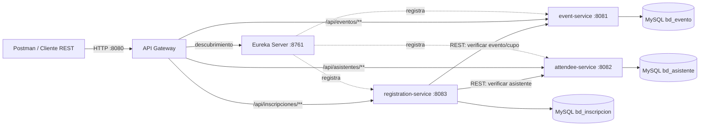

# Diagrama de arquitectura — Laboratorio 16

Cada servicio es un módulo Maven desplegable por separado. Todos están agrupados en el proyecto raíz para facilitar su entrega; cada uno tiene puerto y base de datos propios.
